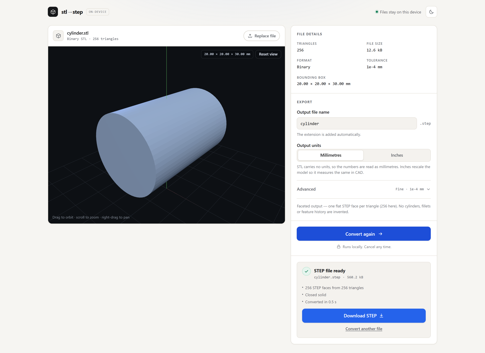

# STL → STEP

Convert STL meshes to STEP (`.step` / `.stp`) **entirely in the browser**. The file
is read with `FileReader`/`ArrayBuffer`, converted by a WebAssembly build of
OpenCascade running in a Web Worker, and handed back as a Blob. Nothing is
uploaded, and the app makes no network requests after its own assets load.



---

## Quick start

```bash
npm install        # also copies the OpenCascade engine into public/occt/
npm run dev        # http://localhost:5173
```

```bash
npm run build      # type-check + production build into dist/
npm run preview    # serve dist/ locally
npm test           # unit tests (STL parsing + vertex welding)
```

`npm install` triggers `scripts/sync-occt-wasm.mjs`, which copies
`replicad_single.js` and `replicad_single.wasm` out of `node_modules` into
`public/occt/`. `npm run dev` and `npm run build` run it too, so a fresh clone
works with no extra steps. `public/occt/` is git-ignored; it is a copy, not a
source file.

### Other scripts

| Command | What it does |
| --- | --- |
| `npm run samples` | Regenerates the sample STLs in `public/samples/`. |
| `npm run verify:step` | Runs the real conversion pipeline over the samples in Node and structurally validates the STEP output. Writes `verify-output/*.step`. |
| `npm run typecheck` | `tsc --noEmit` across all four TS projects. |

Two scripts exist for development rather than for CI:

- `node scripts/measure.mts <triangles>` runs one clean conversion in a fresh
  Node process and prints peak WebAssembly heap, wall time and STEP size. This
  is where the numbers in [Limits](#limits) come from.
- `node scripts/browser-smoke.mjs` drives a real Chrome through load → convert →
  download. It needs `npm i -D playwright-core` and `npm run preview` running,
  so it is not wired into `npm test`.

---

## What it does

1. **Detect** the STL flavour. This is length-driven, not keyword-driven: a
   large share of *binary* STLs start with the ASCII word `solid` in their
   80-byte header, so the file length has to be checked against the declared
   triangle count before trusting the keyword. See
   [`src/lib/stl/detect.ts`](src/lib/stl/detect.ts).
2. **Parse** it — binary via `DataView`, ASCII via a hand-written scanner that
   never tokenises the whole file (a 100k-triangle ASCII STL is ~5 MB of text).
3. **Weld** duplicate vertices using a uniform spatial hash with a
   27-cell neighbourhood search, so points either side of a cell boundary still
   merge. A cube's 36 stored vertices collapse to 8.
4. **Build one planar BRep face per triangle** — three shared vertices, three
   edges, one wire, one face (`BRepBuilderAPI_MakeFace(wire, onlyPlane=true)`).
5. **Sew** the faces (`BRepBuilderAPI_Sewing`) and report free edges (open
   surface) and multiple edges (non-manifold).
6. **Make a solid** (`BRepBuilderAPI_MakeSolid`) *only when sewing reports the
   surface closed*, otherwise export the sewn shell.
7. **Write** the STEP with `STEPControl_Writer` in AP214.

Everything from step 3 onwards runs in a Web Worker, so the page stays
interactive and **Cancel** actually works.

---

## Advanced options

- **Sewing tolerance** (default `1e-4` mm) — used both to merge vertices and to
  let the seamer join coincident edges. Raise it for meshes with float noise or
  split seams; lower it if distinct edges are being swallowed.
- **Output units** — STL carries no units, so the numbers are read as
  millimetres. Choosing **inches** rescales the geometry by 1/25.4 and declares
  `CONVERSION_BASED_UNIT('INCH')`, so the part measures the same in FreeCAD
  either way. Choosing **relabel only** (leave the numbers, change the metadata)
  would silently change the real-world size, so this app does not offer it.
- **Output file name** — the `.step` extension is appended automatically and
  path-hostile characters are stripped.

---

## Limits

These are measured, not guessed. `node scripts/measure.mts <triangles>` reproduces
them in a clean process.

| | |
| --- | --- |
| Warning threshold | 100,000 triangles |
| Hard limit | 200,000 triangles |
| Max file size | 100 MB |
| STEP output size | ~2.6 kB per triangle |

The binding constraint is **memory, not time**. Each triangle becomes a BRep
face with its own plane, wire and three edges, and all of it stays resident while
sewing runs. Measured on a 2023 laptop:

| Triangles | WASM heap | Time | STEP out |
| ---: | ---: | ---: | ---: |
| 20,200 | 454 MB | 27 s | 48 MB |
| 40,328 | 813 MB | 30 s | 98 MB |
| 100,350 | 1739 MB | 71 s | 246 MB |
| 200,344 | 3327 MB | 290 s | 496 MB |

That is ~17 kB of WebAssembly heap per triangle. WebAssembly is capped at a 4 GB
address space and a browser tab is given less than that, so anything past
~100k triangles is a gamble on the visitor's machine — the warning above that
threshold states the estimate, and the worker catches an out-of-memory abort and
explains it rather than dying silently.

The values in `src/lib/limits.ts` are module constants; if you tune them,
re-measure a large mesh first.

---

## The output is faceted

The STEP contains **one flat `ADVANCED_FACE` per input triangle**. A cylinder
with 64 segments comes out as 128 planar facets on the wall plus 128 on the
caps — not one analytic cylindrical surface. It is a faithful copy of your mesh
geometry, but:

- it is **not a parametric CAD model**;
- there are no feature trees, sketches or history;
- there is nothing to "edit parametrically" — you would have to re-export.

No attempt is made to recognise planes, cylinders, fillets or any other
primitive. That is a deliberate non-goal.

---

## Privacy

There is no backend, no account, no analytics, and no telemetry of any kind.
After the page and its assets load, the only network traffic is fetching the
OpenCascade engine on your **first** conversion (22 MB, ~7 MB gzipped, cached
by the browser afterwards). Your STL bytes never leave the tab.

---

## When things are missing

The converter needs no WebGL, no GPU and no graphics drivers — only the preview
does. Browsers and environments that block WebGL are common: Chrome reports
*"A WebGL context could not be created. Reason: disabled by enterprise policy
or commandline switch"* when **Settings → System → Use graphics acceleration
when available** is off, when a machine has no usable driver, and on VMs, remote
desktops and managed corporate devices. A visitor cannot always change that, so
the app does not depend on it:

- **No WebGL context** → the preview switches to a **CPU renderer built on
  Canvas 2D** (`src/components/Preview2D.tsx`): orthographic projection,
  painter's-algorithm depth sort, flat shading from the rotated face normal, a
  bounding-box reference, orbit / zoom / pan, and a point-cloud mode above
  30,000 triangles. Canvas 2D is what the browser already uses to paint the
  page, so it cannot be switched off.
- **A component throws while rendering** → an error boundary shows the message
  with *Try again* / *Reload*, instead of React unmounting the tree and leaving
  an empty document.
- **Three.js cannot read a file our parser accepted** → the preview falls back
  to our own vertex data.

This matters because the failure mode is severe by default: an uncaught throw in
React unmounts the whole tree, so a problem affecting only the picture would
otherwise take the converter down with it.

The Canvas 2D fallback is flat-shaded and slightly slower than WebGL, but it is
a genuine shaded render, not a wireframe sketch. If your browser *does* support
WebGL you get the GPU path automatically — nothing to configure.

---

## Project structure

```
.
├── index.html                     # inline theme script to avoid a flash
├── vite.config.ts
├── vitest.config.ts
├── tsconfig{,.app,.worker,.node,.scripts}.json
│
├── public/
│   ├── occt/                      # generated: engine glue + wasm (git-ignored)
│   └── samples/                   # cube, cylinder, open cone, corrupt
│
├── scripts/
│   ├── sync-occt-wasm.mjs         # node_modules -> public/occt
│   ├── gen-samples.mjs            # writes public/samples/*
│   └── verify-step.ts             # headless end-to-end check
│
└── src/
    ├── lib/
    │   ├── limits.ts              # triangle / size limits
    │   ├── mesh.ts                # shared mesh types, bbox, formatting
    │   ├── options.ts             # ConvertOptions + unit maths
    │   ├── protocol.ts            # worker message contract
    │   ├── stl/
    │   │   ├── detect.ts          # binary vs ASCII sniffing
    │   │   ├── parse-binary.ts
    │   │   ├── parse-ascii.ts
    │   │   ├── weld.ts            # spatial-hash vertex merge
    │   │   └── *.test.ts
    │   └── occt/
    │       ├── engine.ts          # lazy loader + download progress
    │       └── pipeline.ts        # weld -> faces -> sew -> solid -> STEP
    ├── worker/convert.worker.ts
    ├── components/
    │   ├── Dropzone.tsx
    │   ├── ErrorBoundary.tsx      # guarantees a readable message, never a blank page
    │   ├── Feedback.tsx
    │   ├── OptionsPanel.tsx
    │   ├── PreviewCanvas.tsx      # WebGL preview with graceful degradation
    │   └── Preview2D.tsx          # Canvas 2D CPU renderer used when WebGL is blocked
    ├── state/
    ├── App.tsx
    └── styles.css
```

### Why four tsconfig files

`src/lib` is shared between the DOM (UI) and the WebWorker (pipeline) worlds.
Mixing `lib.dom` and `lib.webworker` in one program produces thousands of
duplicate-declaration errors, so the app, the worker, the Node scripts and the
config files each get their own project with the right `lib`.

---

## Deploying

The build is fully static with `base: "./"`, so `dist/` works from a domain
root, a GitHub Pages sub-path, or any preview folder.

### Vercel

```
Build command:   npm run build
Output directory: dist
```

### Netlify

```
Build command:   npm run build
Publish directory: dist
```

### Cloudflare Pages

```
Build command:   npm run build
Build output directory: dist
```

Cloudflare Pages caps a **single asset at 25 MiB**. The engine binary is
21.9 MiB, which fits — and `scripts/sync-occt-wasm.mjs` fails the build loudly
if a future OpenCascade build ever grows past that, rather than producing a
deployment that 404s at runtime.

Make sure your host serves `.wasm` as `application/wasm` (all three do) and does
not set a `Content-Security-Policy` that blocks `wasm-unsafe-eval`.

---

## Testing

```bash
npm test
```

48 tests covering:

- **Format detection** — empty files, truncated binaries, trailing bytes, random
  bytes, over-limit headers, UTF-8 BOMs, and the "binary file that starts with
  `solid`" trap.
- **Binary parsing** — positions, bounding boxes, non-finite coordinates.
- **ASCII parsing** — minimal facets, missing normals, missing `outer`, CRLF,
  unnamed solids, non-ASCII and punctuation-heavy solid names, scientific
  notation, and line-accurate syntax errors.
- **Vertex welding** — corner merging, tolerance behaviour, points straddling a
  cell boundary, capacity growth, degenerate detection, idempotence.
- **Options** — unit conversion round-trips and filename sanitising.

### End-to-end check

`npm run verify:step` loads the *same* engine the browser uses, runs the real
pipeline over every sample, and asserts on the emitted STEP text: ISO-10303-21
header and footer, a `FILE_SCHEMA`, a length unit, the expected number of
`ADVANCED_FACE` entities, and whether a closed shell or solid was produced. It
also exercises inch mode and prints throughput. The `.step` files land in
`verify-output/` for you to open in FreeCAD by hand.

---

## Known limitations

- **Output is faceted.** One STEP face per triangle — see above. This is
  inherent to mesh-to-CAD conversion without feature recognition.
- **Hard triangle limit.** 200k. Above roughly 100k you need a browser willing
  to give a tab 2–3 GB, which is not universal; the conversion fails with an
  explicit out-of-memory message if it cannot. Larger meshes need a desktop
  tool.
- **STEP files are large.** ~2.6 kB per triangle, so a 100k-triangle mesh
  produces a ~250 MB `.step`. STEP is a verbose text format; there is no
  binary option in scope here.
- **No non-manifold repair.** Non-manifold and open meshes are converted and
  reported as warnings; they are not fixed, healed or thickened.
- **Each triangle builds its own three edges** rather than sharing them with its
  neighbours. Sharing would save ~20% of the heap, but it breaks
  `BRepBuilderAPI_Sewing`'s edge accounting — the seamer indexes its input by
  `TShape`, so a pre-shared edge is counted as being used by one face instead of
  two, and every edge reads as "free". The non-manifold and open-surface
  warnings are worth more than the 20%.
- **The Canvas 2D fallback preview is a CPU renderer.** It is flat-shaded and
  orthographic (no perspective), so it looks flatter than the WebGL path, and
  it drops to an unlit point cloud above 30,000 triangles. Painter's-algorithm
  sorting is per-triangle, so coplanar or interleaved facets can sort slightly
  wrong — a software-rendering artefact, not a geometry problem.
- **Degenerate triangles are dropped**, not repaired. If too many collapse, the
  conversion fails with an explanation.
- **Vertex normals from the STL are ignored.** STEP faces are planar, so
  shading is regenerated from geometry.
- **Winding is not corrected.** Face orientation follows the input winding; a
  globally inverted mesh produces an inward-facing solid that CAD tools may
  display with inverted shading. Use consistent winding when exporting.
- **Slow for big meshes.** ~0.7 ms per triangle of solid WebAssembly work. Cancel
  is honoured between batches.
- **Single-threaded.** The `replicad_single` build is used deliberately: the
  multi-threaded one needs `SharedArrayBuffer`, which requires COOP/COEP
  headers that not every static host sets.
- **Safari** works but is slower; very large meshes are more likely to hit its
  memory ceiling.
- **Non-ASCII in ASCII-STL solid names** is tolerated, but the file is decoded
  as UTF-8. A cp1252-encoded name becomes mojibake; the name is only a label,
  so the geometry still converts correctly.

---

## Licenses and credits

This project's own code is MIT.

| Dependency | License | Role |
| --- | --- | --- |
| [OpenCascade](https://www.opencascade.com/) via [`replicad-opencascadejs`](https://github.com/replicadjs/replicad-opencascadejs) | **LGPL-2.1-only** | BRep construction, sewing, STEP writing |
| [Three.js](https://threejs.org/) | MIT | 3D preview only |
| [React](https://react.dev/) | MIT | UI |
| [Vite](https://vite.dev/), [Vitest](https://vitest.dev/), TypeScript | MIT | Tooling |

**OpenCascade is LGPL-2.1.** You may use, study, modify and redistribute it
provided you comply with the licence. This project uses it as an unmodified
WebAssembly binary linked at runtime — the classic LGPL "shared library"
arrangement — so anyone receiving this app can obtain the corresponding source
(<https://github.com/Open-Cascade-SAS/OCCT>) and replace the binary. The
compiled artefact used here comes from the
[`replicad-opencascadejs`](https://github.com/replicadjs/replicad-opencascadejs)
build; its own `LICENSE` file ships with the npm package.

This is not legal advice: if you redistribute this app, read both licences and
comply.